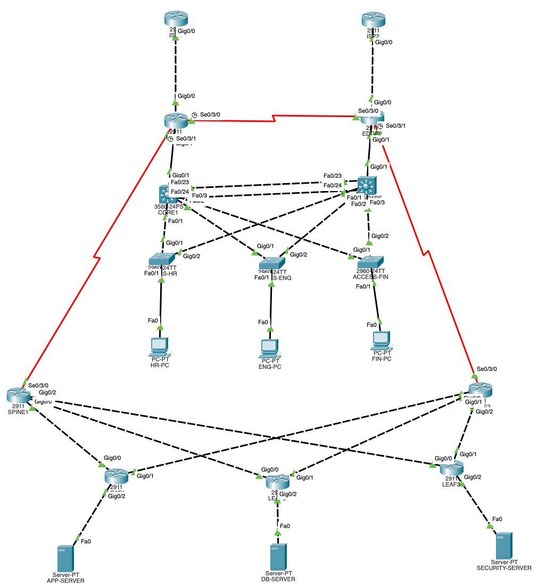

# Enterprise Network Design

## Overview

Designed and configured a redundant enterprise network in Cisco Packet Tracer. The project combines VLAN segmentation, Layer 2 and Layer 3 networking, gateway and link redundancy, dynamic routing, DHCP, and failure testing. The network was built with two multilayer core switches, access switches, edge routers, spine/leaf routers, servers, and simulated external connectivity.

## Network Topology



## Technologies

- Cisco Packet Tracer
- Cisco IOS
- VLANs and 802.1Q trunking
- Inter-VLAN routing
- Rapid-PVST/RSTP
- LACP EtherChannel
- HSRP
- OSPF
- BGP
- DHCP
- IPv4 subnetting

## Network Configuration

### VLANs

| VLAN | Department | Network |
|---|---|---|
| 10 | HR | 10.10.10.0/24 |
| 20 | Engineering | 10.10.20.0/24 |
| 30 | Finance | 10.10.30.0/24 |
| 99 | Management | 10.10.99.0/24 |

Configured VLANs across the switching network and used 802.1Q trunking to carry the required VLANs between switches.

### Switching and Redundancy

- Configured Rapid-PVST/RSTP to prevent Layer 2 loops and provide redundant paths.
- Configured LACP EtherChannel between CORE1 and CORE2 using FastEthernet0/23 and FastEthernet0/24.
- Tested EtherChannel redundancy by shutting down one physical member and verifying the remaining link continued forwarding traffic.
- Configured HSRP on VLANs 10, 20, 30, and 99.
- Used virtual gateway addresses:
  - VLAN 10: 10.10.10.1
  - VLAN 20: 10.10.20.1
  - VLAN 30: 10.10.30.1
  - VLAN 99: 10.10.99.1
- Configured HSRP preemption and interface tracking.
- Tested gateway failover between CORE1 and CORE2.

## Routing

### OSPF

- Configured OSPF process 10 for internal dynamic routing.
- Established OSPF neighbor relationships between the core and edge routing devices.
- Verified neighbors reaching the FULL/BDR state.
- Verified internal routes learned through OSPF.
- Verified the default route being learned through OSPF.

### BGP

- Configured BGP to demonstrate external and multi-AS routing.
- Used separate autonomous systems for the enterprise, spine, leaf, and simulated ISP networks.
- Configured eBGP peer relationships.
- Practiced route advertisement and verification between autonomous systems.
- Used a spine-leaf routing design to provide redundant paths.

## DHCP

- Configured DHCP for the internal VLANs.
- Verified DHCP bindings and client address assignments.
- Tested connectivity from DHCP-assigned clients to internal and remote networks.

## Connectivity and Failover Testing

- Tested connectivity between internal VLANs.
- Tested connectivity to remote server networks.
- Tested HSRP gateway failover.
- Tested EtherChannel member-link failure while maintaining connectivity.
- Verified VLAN and trunk operation.
- Verified OSPF adjacencies and routing tables.
- Verified DHCP bindings.
- Verified BGP configuration.

## Key Cisco IOS Commands

```text
show ip interface brief
show vlan brief
show interfaces trunk
show etherchannel summary
show standby brief
show ip ospf neighbor
show ip route
show ip route 0.0.0.0
show ip dhcp binding
show ip bgp summary
```

## Skills Demonstrated

- Enterprise network design
- Cisco IOS configuration
- VLAN segmentation
- Layer 2 and Layer 3 networking
- 802.1Q trunking
- RSTP
- HSRP high availability
- LACP EtherChannel
- OSPF
- BGP and multi-AS routing
- DHCP
- Network troubleshooting
- Redundancy and failover testing
- Cisco Packet Tracer
